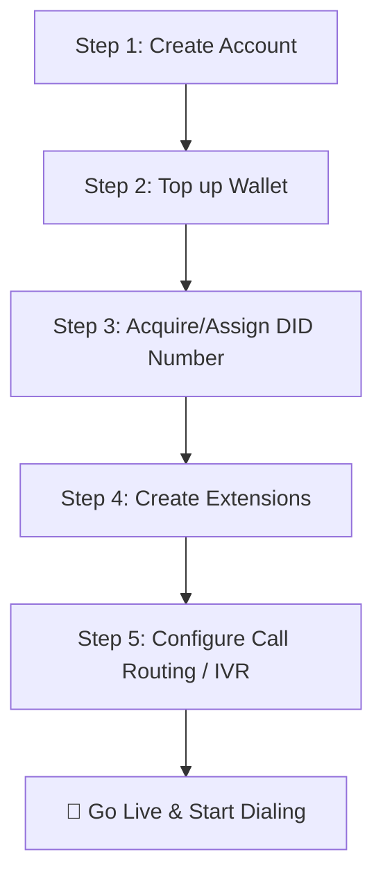

# 🌐 Cloud PBX Product Documentation Portal

Welcome to the comprehensive, professional user documentation for **Cloud PBX**, your advanced Cloud PBX, Telecom, and Subscription Billing Platform. Whether you're setting up a small business phone system or running an enterprise contact center, this guide provides the step-by-step operating blueprints you need.

---

## 🗂️ Documentation Directory & Navigation

Use the navigation structure below to jump quickly to any module or specific implementation guide.

### 🗺️ Sidebar Navigation Structure

| 🚀 Getting Started | ⚙️ Core Features | 💼 Advanced Routing | 📊 Performance & Administration |
| :--- | :--- | :--- | :--- |
| • [1. Introduction](#1-introduction-to-cloud-pbx) | • [5. Phone Numbers](#5-phone-numbers) | • [9. Audio Library](#9-audio-library) | • [13. Call Records (CDRs)](#13-call-records) |
| • [2. Onboarding Quickstart](#2-getting-started) | • [6. Extensions (SIP)](#6-extensions) | • [10. DIDs Management](#10-dids) | • [14. Analytics & Reports](#14-analytics) |
| • [3. Dashboard Guide](#3-dashboard-guide) | • [7. Ring Groups](#7-ring-groups) | • [11. DID Forwards](#11-did-forwards) | • [15. User Management](#15-user-management) |
| • [4. Wallet & Billing](#4-wallet--billing) | • [8. IVR Menus](#8-ivr-menus) | • [12. Schedules](#12-schedules) | • [16. Business Workflows](#16-common-business-workflows) |
| | | | • [17. Troubleshooting](#17-troubleshooting) |
| | | | • [18. Help & FAQ](#18-faq) |
| | | | • [19. Best Practices](#19-best-practices) |
| | | | • [20. Conclusion](#20-conclusion) |

---

## 🏁 The Cloud PBX Professional Onboarding Flow

To get your business live on the Cloud PBX platform in less than 15 minutes, follow this sequence:

---
---

## 1. Introduction to Cloud PBX

### 🌟 What is Cloud PBX?
**Cloud PBX** is an enterprise-grade, all-in-one Telecom SaaS platform that unifies global voice carrier networks with a modern, easy-to-use Private Branch Exchange (PBX) software suite. Designed with business agility in mind, Cloud PBX provides companies with the power to buy virtual numbers worldwide, deploy automatic call distribution, construct multi-layer Interactive Voice Response (IVR) systems, and manage user communications seamlessly.

### 👥 Who It Is For
*   **Small & Medium Businesses (SMBs)**: Eliminate expensive legacy phone hardware; setup professional digital receptionists in minutes.
*   **High-Velocity Sales Teams**: Spin up virtual phone extensions instantly, configure regional outbound numbers, and leverage custom rate cards to optimize carrier costs.
*   **Customer Support & Contact Centers**: Manage team call routing, queue depth, live calls, and track overall agent performance.
*   **Distributed Remote Teams**: Enable global internal communications so employees can answer corporate phone lines securely from anywhere in the world using any SIP-enabled softphone or desktop IP phone.

### ⚡ Main Capabilities
*   **Instant Virtual Numbers (DIDs & TFNs)**: Gain access to local presence and toll-free inventory spanning numerous regions.
*   **Intelligent Inbound Routing**: Direct calls dynamically to specific extensions, ring groups, external mobile devices, or multi-level menus based on live scheduling logic.
*   **Hybrid Real-Time Ledger System**: Combines a standard fiat wallet with "Free Minute" grants. Calls are processed synchronously, updating your financial balance down to the microsecond.
*   **Concurrency Shielding**: Safeguards accounts against race-conditions using advanced transactional advisory locks to guarantee financial precision during intensive operations.

### 📡 Telecom Infrastructure Overview
The Cloud PBX platform consists of two distinct, synchronized architectural engines:
1.  **NodeJS Operational Control Center**: Serves as the user interface, handling wallet management, Stripe digital checkouts, recurring plan provisioning, user directories, and operational logic.
2.  **Live Telephony Media PBX**: Orchestrates real-time Session Initiation Protocol (SIP) signaling and Real-time Transport Protocol (RTP) streams. It handles the audio, dialplans, and generates immediate Call Detail Records (CDRs) that feed into our dashboard telemetry.

---

## 2. Getting Started

Starting your journey with Cloud PBX requires only a few minutes of setup time.

### 📧 Account Signup & Verification
1.  Navigate to the official [Cloud PBX Portal](https://telecom-platform.com/).
2.  Click the **Sign Up** button at the top right.
3.  Fill out your **Company Registration Profile** or **Individual Profile**:
    *   *Identity Type*: Select whether you are registering as an individual user or a registered corporation.
    *   *Corporate Details*: Provide your Registered Company Name and Tax/VAT ID (if applicable).
    *   *Contact Information*: Use a valid administrative email and telephone number.
    *   *Address Verification*: Provide an authorized billing address required by international regulatory bodies for assigning phone assets.
4.  Accept the Terms of Service and click **Create Account**.
5.  Check your email for the security verification link. Clicking this authenticates and unlocks your core platform environment.

### 🔑 Login
Enter your verified email address and secure password on the login screen. If your organization enforces Multi-Factor Authentication (MFA), you will be prompted to enter your temporary authentication code from your mobile app at this time.

### 🧭 Unified Dashboard Overview
Upon successfully entering the system, you are taken directly to the operational Dashboard Hub. The interface is carefully structured to present actionable intelligence instantly.

---
> 📸 **[SCREENSHOT PLACEHOLDER: MAIN_DASHBOARD_TOUR]**
> **Action to Capture**: Open the primary Cloud PBX landing dashboard.
> **What should be shown**: The dark-themed header, Real-time KPIs (Balance, Minutes Remaining), the System Health Indicator, Active Calls monitor, and the main navigation sidebar loaded.
---

### 🏦 Understanding Wallet Balances & Resource Grants
Unlike legacy systems that invoice you post-facto, Cloud PBX utilizes a **Hybrid Real-Time Billing Architecture**:
*   **Fiat Wallet Balance**: Your currency funds (e.g., USD). This operates as your credit engine for buying new phone numbers, paying monthly plan subscriptions, and routing standard per-minute calls.
*   **Free Minutes Grant**: Most enterprise plans include a bundled bank of monthly "Free Minutes." When your extension makes a billable call, our platform intelligently checks if you have minutes left. If yes, the cost is subtracted from these seconds first, keeping your fiat wallet untouched. 

### 💳 Adding Funds
Cloud PBX supports both instant digital payments and corporate manual settlements:
1.  Click **Add Funds** from the dashboard navigation.
2.  **Digital Checkout (Stripe)**: Select the amount you wish to add (e.g., $50, $100, $500), select your payment method (Credit Card, Apple/Google Pay), and securely submit. The server's Stripe integration verifies the webhook within milliseconds and automatically credits your live balance.
3.  **Manual Settlements**: For enterprise wires or bank transfers, administrators record reference ID tokens, which credit the wallet immediately once the bank transaction has cleared the ledger.

### 📊 Understanding Active Calls and Queue Depth
*   **Active Calls**: A real-time counter exhibiting the exact number of concurrent SIP sessions operating on your account right now.
*   **Queue Depth**: Shows how many external customers are currently waiting in a Ring Group holding pattern before an agent answers. Keeping an eye on this number helps managers reallocate personnel to reduce waiting times.

---

## 3. Dashboard Guide

The **Dashboard Hub** provides a unified "Command Center" window into your telecom fleet's operational vitality.

### 🩺 System Health Indicator
Located at the top of your window, the **System Health Bar** continuously monitors connection statuses:
*   **Online / Operational (Green)**: The SIP Core engines, APIs, Database layers, and WebSocket connectors are communicating perfectly.
*   **Maintenance / Degraded (Amber)**: Minor routine maintenance is underway. Active systems continue working, but management configurations may temporarily queue.
*   **Offline (Red)**: Critical local network alert. (See [Troubleshooting](#17-troubleshooting)).

### 💰 Live Metric Widgets
1.  **Available Balance Card**: Displays your fiat currency wallet. Updates in real-time via WebSocket events the microsecond any call ends.
2.  **Free Minutes Counter**: Tracks your remaining monthly calling allowance formatted clearly in total minutes remaining.
3.  **Concurrent Channels Used**: Graph showing your peak bandwidth usage over a rolling 24-hour period.

### 📝 Recent Transactions & Log Ledger
Beneath the metrics grid lies the chronological ledger. This aggregates:
*   Stripe deposits completed.
*   Subscription Plan renewals charged.
*   Number purchasing and activation fees.

### 🔔 Alerts, Warnings & Recharge Notifications
The dashboard employs active visual warnings based on your **Burn Rate**:
*   **🟡 Warning Threshold**: Triggers when your projected wallet balance drops below 5 days of average operation. Shows a yellow notification banner at the top.
*   **🔴 Low Balance Crisis**: Triggers when your balance is within 24 hours of zero. You will see an aggressive visual warning prompt advising immediate recharge to prevent automatic system suspension.

---

## 4. Wallet & Billing

Managing the financial health of your communication suite is imperative to maintaining uptime. The Wallet module represents the centralized financial command ledger of Cloud PBX.

### 🧩 The Hybrid Wallet Mechanics
Every customer receives a virtual ledger consisting of:
1.  **`fiat_balance`**: Real-world capital.
2.  **`free_seconds`**: Digital time buckets granted by subscription plans.
3.  **`credit_limit`**: An administrative courtesy threshold. By default, it is `0.00`. If an administrator configures a $50 Credit Limit, your services will remain functional even if your `fiat_balance` reaches `-$49.99`.

### 💳 Recharge Workflow
#### Option A: Instant Credit Card Top-Up (Self-Service)
1.  Go to **Wallet** -> **Recharge**.
2.  Input amount and click **Pay Online**.
3.  Complete the HTTPS-encrypted Stripe checkout screen.
4.  Return to Cloud PBX; your balance widget updates instantly via real-time WebSockets.

#### Option B: Corporate Wire & Manual Credit (Admin-Facilitated)
1.  Perform a standard ACH, SEPA, or Wire transfer to the Cloud PBX corporate bank account (found on your Invoice settings).
2.  Submit your Transaction Reference Token to support, or wait for your Account Manager to update the record manually.
3.  The Admin uses our cryptographically signed Manual Billing API to lock the row, inject the funds, and document the audit trail under transaction type `manual_payment`.

### ⚙️ The Automated Billing Engine (Invisible Accountant)
Cloud PBX executes an automated system-wide audit daily at **02:00 AM**:
1.  It scans all customer accounts to find subscriptions reaching their `next_billing` date.
2.  It executes a **Solvency Check**: `(fiat_balance + credit_limit) >= plan_cost`.
3.  If solvent, it deducts funds, extends the subscription date forward exactly one billing cycle, and emits an official invoice marked **Paid**.
4.  **Non-Rollover Execution**: It runs an expiry purge cleaning out all remaining unconsumed seconds from the previous month, and instantly injects the new fresh grant of minutes.
5.  If insolvent, the renewal fails, triggering automated protection routines that temporarily suspend associated telephone assets.

### 📉 Burn Rate & Proactive Recommendations
The Analytics engine evaluates your daily aggregate spend:
*   Calculates Average Daily Usage (Carrier charges + DID maintenance).
*   Generates an estimate of "Days Remaining" until balance exhaustion.
*   *Recommendation*: We strongly suggest maintaining a minimum buffer equivalent to 15 days of operations to protect critical voice lines from interruption.

---
> [!WARNING]
> **Service Interruption**: If a daily renewal fails due to insufficient balance, all linked voice assets (DIDs, Outbound Trunks, and PBX Extensions) transition to an **Inactive/Suspended** state. During this time, incoming callers will hear a standard out-of-service message. Reactivate instantly by topping up and clicking **Trigger Manual Renewal**.
---

---

## 5. Phone Numbers

Phone Numbers represent your organization's gateways to the global PSTN (Public Switched Telephone Network).

### 🔍 Overview & Feature Function
Virtual numbers within Cloud PBX behave identically to standard hardware copper lines but live completely in the cloud.
*   **What it is used for**: Serving as your main public contact lines, local presence numbers for regional markets, or tracking lines for marketing campaigns.
*   **Why it matters**: Without phone numbers, external callers cannot dial into your PBX, and your agents cannot project a professional Caller ID when making outbound calls.

### 🛒 Step-by-Step Setup Instructions: Buying a Number
1.  Navigate to the **Phone Numbers** module in your sidebar.
2.  Click the **Buy Numbers** button on the top right.
3.  **Configure Search Filters**:
    *   Select the target Country (e.g., USA, UK, Canada).
    *   Select the Number Type: Local (geographic DID) or Toll-Free (TFN).
    *   (Optional) Enter a preferred Area Code or search pattern.
4.  Review the search results list displaying monthly rental rates and capabilities (Voice, SMS).
5.  Select your desired number(s) and click **Purchase Number**.
6.  Confirm the checkout. The monthly rental amount is instantly deducted from your fiat wallet, and the system's **Asset Provisioning Engine** assigns the DID exclusively to your account inventory.

### 🔄 Common Workflows: Allocating Inventory
1.  Locate the purchased number in your **Phone Numbers Table**.
2.  Select the "Routing Target" dropdown.
3.  Connect the number to an destination:
    *   Route to **IVR Menu** (e.g., "Main Auto-Attendant")
    *   Route to **Ring Group** (e.g., "Sales Ring Group")
    *   Route to an individual **Extension** (e.g., Direct extension 101)
4.  Click **Save Configurations**. The PBX routing matrix refreshes immediately.

### 💡 Example Business Use Cases
*   **Local Presence**: A New York-based company buys local area code numbers in Los Angeles (310), Chicago (312), and Miami (305) to appear local to regional clients, dramatically boosting outbound sales answer rates.
*   **Toll-Free Support Line**: Buying an 800-series Toll-Free Number to ensure nationwide callers face no carrier charges when seeking customer support.

---

## 6. Extensions

Extensions are the core communications endpoints of your internal business layout. 

### 📞 Overview & Configuration Basics
*   **What it is used for**: Dedicated digital phone lines assigned to specific employees, desks, or software platforms (softphones).
*   **Why it matters**: Extensions enable internal intercom dialing between teammates completely free of charge and serve as the final termination points where external callers speak to a real person.

### 🛠️ Step-by-Step Setup: Creating an Extension
1.  Open the **Extensions** tab in the control center.
2.  Click **Create Extension**.
3.  Complete the Configuration Specs:
    *   **Extension Number**: Assign an internal sequence number (e.g., `101`, `102`).
    *   **Display Name**: The employee's name (e.g., "John Doe").
    *   **SIP Username**: Auto-generated by the system for security.
    *   **SIP Password**: Click 'Generate' to create an enterprise-secure alphanumeric password.
4.  **Adjust Calling Permissions**:
    *   Enable/Disable Outbound Calling privileges.
    *   Set Outbound Caller ID (Pick from your list of DIDs).
    *   Toggle Call Recording: (Always, Never, or On Demand).
5.  Click **Save**. The extension enters the database as an active asset.

---
> 📸 **[SCREENSHOT PLACEHOLDER: EXTENSION_SETUP_DETAILS]**
> **Action to Capture**: Open the 'Create Extension' configuration modal showing fully generated SIP credentials.
> **What should be shown**: Fields for Display Name, Ext Number, SIP Server details, SIP Username, and hidden Password string visible next to a copy button.
---

### 📱 Registering Your SIP Software/Hardware
To start making calls, input your generated SIP credentials into any standard RFC-compliant communications platform:
1.  **Standard SIP Endpoint Details Needed**:
    *   *SIP Domain / Proxy / Server*: Provided in your Extension view (e.g., `sbc.telecom-platform.com`).
    *   *SIP Username*: (e.g., `agent101_bx`).
    *   *SIP Password*: The complex string generated above.
2.  **Open your Softphone Application** (e.g., MicroSIP, Zoiper, or a Yealink desk phone).
3.  Input the credentials into the app's "Account Settings" and hit **Register**.
4.  When the status indicator in the softphone turns **Green (Registered)**, you are ready to dial.

### ⚠️ Important Warning: SIP Security
> [!CAUTION]
> **SIP Credentials Exposure**: SIP endpoints are prime targets for automated botnet scanners looking to execute Toll-Fraud. NEVER share your SIP passwords via plain email or Slack, and NEVER use weak passwords (e.g., matching the extension number). Always use the complex generator provided by Cloud PBX.
---

## 7. Ring Groups

Ring Groups bundle multiple Extensions together so incoming calls can be answered by any available team member.

### 👥 What it is Used For
*   Distributing inbound traffic efficiently across sales, support, or administrative departments instead of burdening a single receptionist.

### 🔁 Call Distribution Paradigms
When configuring your group, choose your preferred strategy:
1.  **Simultaneous Ringing (Ring-All)**: Every single extension assigned to the group rings at the exact same millisecond. The first employee to lift the receiver claims the call, and other extensions immediately cease ringing. Excellent for highly competitive sales forces.
2.  **Sequential Ringing (Round-Robin/Hunt-Group)**: The call rings Extension A first. If not answered within 10 seconds, it moves to Extension B, then Extension C. Perfect for support queues to share agent workloads fairly.

### 🛠️ Step-by-Step Ring Group Setup
1.  Navigate to **Ring Groups** -> **Create Ring Group**.
2.  **General Info**: Name the group (e.g., "General Support") and assign an internal Extension (e.g., `500`).
3.  **Select Members**: Check the boxes next to the Extensions you wish to include in this group.
4.  **Ring Strategy**: Select `Simultaneous` or `Sequential`.
5.  **Ring Time**: Set the duration in seconds (e.g., 20 seconds) before the strategy gives up.
6.  **Failover Destination**: If NO agents in the Ring Group pick up the call within the specified timeframe, define where the call should go:
    *   Transfer to Voicemail.
    *   Route to a secondary Group or IVR Menu.
    *   Forward to an external Out-of-Hours mobile number.
7.  Click **Save Group**.

### 📈 Best Practice: Team Routing
*   Keep Ring Times to a maximum of 20–25 seconds before triggering a failover. Callers become frustrated if a phone rings indefinitely without response or redirection to a digital receptionist/voicemail box.

---

## 8. IVR Menus

Interactive Voice Response (IVR) Menus act as your 24/7 Digital Auto-Attendant, routing callers automatically based on keypad inputs.

### 🤖 Overview
*   **What it is used for**: *"Thank you for calling Cloud PBX. Press 1 for Sales, 2 for Support, or 0 to speak to an agent."*
*   **Why it matters**: IVRs automate inbound triage, eliminating the overhead of human receptionist triage while ensuring callers are connected directly to the correct department every time.

### 🛠️ Call Flow Tree Setup
1.  Go to the **IVR Menus** module -> **Create New IVR**.
2.  **Initial Settings**:
    *   *Name*: Give it a functional title (e.g., "Main Day Menu").
    *   *Greeting Audio*: Select an audio file from your **Audio Library** (e.g., "main_greeting.wav"). This is the voice file the caller hears first.
3.  **Configure Keypress DTMF Options**:
    Map digits 0-9, * (Star), and # (Hash) to destination endpoints:
    
    | Keypress (DTMF) | Destination Action | Target Option |
    | :--- | :--- | :--- |
    | **Press 1** | Transfer to Ring Group | `Sales Group` |
    | **Press 2** | Transfer to Extension | `Billing (105)` |
    | **Press 3** | Play Audio Only | `Office Hours Info` |
    | **Press 0** | Transfer to Agent | `Reception (101)` |
    
4.  **Timeout Behaviors**: Set what happens if the caller presses absolutely nothing. (Recommended: *Replay greeting once, then transfer to Option 0*).
5.  Click **Create Menu**.

### 🔄 Scheduled Routing Logic
A common sophisticated deployment involves chaining **Schedules** with your IVRs:
*   **Daytime Route**: During hours `09:00 - 17:00`, route incoming calls to your `Main Day Menu` IVR.
*   **Nighttime Route**: During hours `17:01 - 08:59`, route incoming calls to a secondary `After Hours` IVR or directly to an Emergency Forwarding service.

---

## 9. Audio Library

The **Audio Library** is the centralized repository storing all digital audio assets executed by your PBX systems.

### 📁 Overview
Instead of managing sound assets haphazardly across various extensions, the Audio Library enables global management of your corporate greetings, music-on-hold tracks, and custom voicemail prompt assets.

### 🎵 Supported Formats & Optimization
To guarantee crystal-clear playback quality across carrier-grade codecs, follow these standards:
*   **Recommended Encoding**: WAV format, 8kHz or 16kHz, Mono, 16-bit.
*   **Supported Alternative Formats**: Standard MP3 (will be automatically transcoded by the Cloud PBX Engine).
*   *Tip*: For best results, record audio using a dedicated USB microphone or generate prompts using advanced Text-to-Speech AI tools to ensure your greetings sound highly professional.

### 🛠️ Step-by-Step Upload & Implementation
1.  Navigate to **Audio Library** -> **Upload File**.
2.  Click **Choose File**, browse to your WAV/MP3 recording, and assign a descriptive label (e.g., `holiday_greeting_2026`).
3.  Click **Upload & Verify**. The system analyzes the codec and renders the file active.
4.  **Integration**: Return to your **IVR Module** or **Ring Group settings**, click the "Greeting Audio" dropdown, and select your newly uploaded asset.

---

## 10. DIDs

Direct Inward Dialing (DID) configurations govern the high-level mapping of public lines to internal services.

### 🗺️ Overview
While the *Phone Numbers* module acts as the storage and purchase catalog, the **DIDs Routing Control** dictates exactly what path electrical SIP traffic follows the moment it enters the Cloud PBX boundary from the global carrier.

### 🛠️ Routing Direct DIDs
1.  Open the **DIDs Control Page**.
2.  Locate the Target Number.
3.  Select **Route Type**:
    *   `Direct Extension`: Sends all incoming calls strictly to one single desk phone. Excellent for assigning unique private numbers to executives.
    *   `IVR Flow`: Routes general traffic into automated tree menus.
    *   `Ring Group`: Delivers the call to shared support and sales team layouts.
4.  Select the corresponding target object and hit **Update Route**.

---

## 11. DID Forwards

DID Forwards bridge your digital PBX environment with standard external telephone carrier networks (cell phones, residential lines, offshore centers).

### 🔀 Call Forwarding Paradigms
*   **What it is used for**: Instantly rerouting calls to an employee’s mobile device when they leave the physical office.
*   **Why it matters**: Guarantees zero missed calls, especially for distributed sales agents or emergency support responders who cannot remain glued to their softphone applications.

### 🛠️ Configuration Steps: External Routing
1.  Open **DID Forwards** -> **Create Forward**.
2.  Select the trigger Number/Extension from which traffic will be redirected.
3.  Input the **External Target Number** exactly in complete international format (e.g., `+12025550143`).
4.  Choose **Forwarding Type**:
    *   *Unconditional*: Immediately pushes every call directly to the external mobile.
    *   *No-Answer Failover*: Rings the internal extension for 15 seconds; if unanswered, only *then* diverts the call to the mobile phone.
5.  Click **Create Redirect**.

### 💰 Financial Impact Warning
> [!IMPORTANT]
> **Forwarding Charges**: Forwarding a call to an external mobile number requires placing an *Outbound Leg* over the telecom networks. This outbound leg consumes your fiat balance or Free Minutes according to your Rate Card, exactly like a standard outbound call placed from an extension.
---

## 12. Schedules

**Schedules** introduce temporal logic to your communications, shifting call routing dynamics automatically based on real-time clocks.

### ⏰ Business Hours Setup
1.  Go to **Schedules** -> **Create Schedule Profile**.
2.  Name the profile (e.g., "Headquarters Standard Time").
3.  Select your active **Timezone**. (Critical for multi-state/international operations).
4.  **Define Rules Grid**:
    *   *Monday - Friday*: Set range `08:00` to `18:00`.
    *   *Saturday - Sunday*: Toggle to `Closed`.
5.  Click **Create**.

### 🎄 Holiday Routing
Create **Schedule Overrides** for specific calendar dates (e.g., January 1st, December 25th):
1.  Inside your Schedule Profile, select the **Add Holiday Exception** card.
2.  Input the Target Date and set status to `Closed All Day`.
3.  Upload an audio greeting to your Audio Library labeled `holiday_closed.wav`.
4.  Map the exception route to play the custom greeting before ending the call, informing clients that your staff is celebrating a holiday.

---

## 13. Call Records

Call Detail Records (CDRs) are the empirical evidence logs documenting every interaction across your system.

### 🔎 View, Filter, and Track
*   **What it is used for**: Researching billing discrepancies, confirming calls reached target agents, analyzing call durations, and investigating security questions.
*   **Why it matters**: Complete accountability. Knowing exactly who called, when, and how much it cost provides managers absolute control.

### 📋 Reading the CDR Matrix
The matrix exhibits:
*   **Timestamp**: Date/Time the SIP INVITE was established.
*   **Direction**: `Inbound`, `Outbound`, or `Internal`.
*   **Source**: The Extension number or external Caller ID initiating the call.
*   **Destination**: The exact dialed digits or receiving extension.
*   **Duration**: Displayed in precise seconds and formatted into minutes.
*   **Status**: `Answered`, `No Answer`, `Busy`, or `Failed`.
*   **Charge**: The exact decimal amount deducted from the customer wallet for that specific carrier routing leg.

### 📥 Filtering & Data Exports
1.  Use the **Calendar Filter** to select specific date ranges (e.g., *Last Week*, *Month-to-Date*).
2.  Apply **Preset Filters** (e.g., *Only Outbound*, *Only Answered*).
3.  Click **Export Report** to download the filtered dataset in standard `.CSV` or `.PDF` formats for importing into third-party business intelligence systems.

---

## 14. Analytics

While Call Records provide transactional raw details, the **Analytics Engine** transforms them into visual strategic intelligence.

### 📈 Critical Metric Groups
1.  **Performance Metrics**:
    *   *Answer Rate %*: Measures your workforce efficiency in picking up incoming calls before abandonment.
    *   *Average Handle Time (AHT)*: Tracks the average conversation length per department.
2.  **Volume & Traffic Analytics**:
    *   *Total Call Count Timeline*: A clean histogram mapping call volumes against hours of the day. Helps identify "Peak Hour Trends" to inform staffing decisions.
3.  **Financial Telemetry**:
    *   *Aggregate Spend Breakdown*: Visualizes daily wallet burn rates.
    *   *Minutes Exhaustion Graph*: Projects your current rate of monthly Free Minute consumption.

---
> 📸 **[SCREENSHOT PLACEHOLDER: ANALYTICS_HISTOGRAMS]**
> **Action to Capture**: Open the primary Analytics suite showing visual charts.
> **What should be shown**: A line graph charting calls over time, circular charts for inbound/outbound distribution, and Top Extensions leaderboard rankings.
---

---

## 15. User Management

Control who accesses the Cloud PBX Command Portal and restrict modification permissions using enterprise Roles.

### 👤 User Roles and Security Clearance Policies
Cloud PBX segregates portal access into defined tiers:

| User Role | Core Permissions | Ideal For |
| :--- | :--- | :--- |
| **Super Admin** | Full global access: Billing, Routing, User provisioning, APIs. | Business Owners / CTOs |
| **Billing Admin** | Restricted to adding funds, viewing invoices, rate cards. | Accountants / CFO office |
| **Telecom Manager** | Configure DIDs, Extensions, IVR, and Ring Groups. Cannot access payment screens. | IT Managers / Telecom Ops |
| **Reports Viewer** | Read-only access to Call Records and Analytics dashboards. | Team Supervisors |

### 🛠️ Adding Team Users
1.  Go to **User Management** -> **Invite Team Member**.
2.  Input Email Address, First Name, Last Name.
3.  Check the radio button for the desired **Permission Role**.
4.  Click **Send Invitation**. The user will receive an email with secure link instructions to configure their credentials.

---

## 16. Common Business Workflows

Below are step-by-step implementation architectures showing how to deploy common corporate environments.

### 🏢 Workflow A: Solopreneur / Small Office Setup
**Objective**: Create a professional business facade routing to a single founder’s mobile phone, while filtering out robo-calls.
1.  Buy **one Local DID**.
2.  Create **one Extension (101)** and register it to a softphone.
3.  Create a basic **Schedule** (Open 09:00 - 17:00).
4.  Build a simple **IVR Menu**: *"Welcome. Please press 1 to be connected."* (This acts as a spam wall).
5.  Configure DTMF **Option 1** to route to **Extension 101**.
6.  Configure a **Failover Call Forward** on Extension 101: If not answered in 15 seconds, forward to the founder's cell phone number.

### 📞 Workflow B: 24/7 Automated Support Center
**Objective**: Route callers to a pool of support agents during business hours, and an automated answering service at night.
1.  Procure a **Toll-Free Number (TFN)**.
2.  Create **5 Extensions** for the Support team.
3.  Create a **Ring Group (600)** using `Sequential Round-Robin` strategy containing all 5 team extensions. Set Ring time to 20s.
4.  Create a **Schedule Profile** (09:00 to 18:00, Mon-Fri).
5.  **Inbound Routing Map**:
    *   *Condition: Within Working Hours* -> Deliver call to **Ring Group 600**.
    *   *Condition: Outside Working Hours* -> Route call to **IVR Night Menu** (plays *"Our office is currently closed"* greeting, then transfers to Support Voicemail box).

---

## 17. Troubleshooting

When anomalies occur, use this diagnostic tree to restore normal operations quickly.

### 🌐 1. SIP Registration Failures ("No Service" on Desk phone)
*   **Symptoms**: Your softphone shows red/offline status. Outbound calls fail instantly.
*   **Verification Path**:
    1.  *Internet Integrity*: Verify the computer/device has active web access.
    2.  *Credential Inspection*: Open the Extensions tab. Ensure you have copied the SIP Username and complex Password exactly, without trailing spaces.
    3.  *Firewall Configuration*: Ensure your office Router allows outbound **UDP Port 5060** (SIP signaling) and **UDP Ports 10000-20000** (RTP audio traffic). Many standard home routers enable a setting called **SIP ALG** which aggressively blocks VoIP packets; **disable SIP ALG** immediately.

### 🚫 2. Call Routing Failures ("Target Busy" / Immediate Hang-up)
*   **Verification Path**:
    1.  *Check Wallet Health*: Look at your Dashboard. If your fiat wallet is zero or negative AND you have no credit limit, the SIP Core engine blocks outbound calls dynamically. **Top up wallet immediately**.
    2.  *Route Map Assessment*: Open the DID configuration. Verify the public number has an active routing target assigned (e.g., connected to an actual IVR or Extension). If unmapped, the PBX drops the call.

### 🔇 3. One-Way Audio (You can hear them, they cannot hear you)
*   **Verification Path**:
    *   This is almost universally caused by Network Address Translation (NAT) issues.
    *   *Resolution*: In your softphone/desk phone network settings, toggle **STUN Server** to `Enabled` (use a public STUN e.g., `stun.l.google.com:19302`), and set your NAT Keep-alive frequency to **30 seconds**.

---

## 18. FAQ

### 💸 General & Billing Questions
**Q1: How does the Cloud PBX Hybrid Billing ledger operate?**  
Every account contains a Fiat Wallet and a Free Minutes bank. Outbound call costs deduct from Free Minutes first. If the minutes are exhausted, the system switches seamlessly to deducting decimals from your Fiat balance.

**Q2: Do my unused Free Minutes roll over to the next billing cycle?**  
No. Cloud PBX implements a strict Non-Rollover policy. Every month during the 02:00 AM Billing Engine routine, old minute balances are purged entirely and replaced with a completely fresh grant bundle.

**Q3: What is a "Credit Limit" and how do I request one?**  
A Credit Limit is an administrative threshold allowing you to operate briefly with a negative fiat balance without interruption. Enterprise clients can request custom Credit Limits from their Account Executive.

**Q4: Can I download VAT or Tax Invoices for past Stripe recharges?**  
Yes. Inside the **Wallet** module under the **History** tab, every completed recharge features a "Download PDF Invoice" button suitable for accounting submission.

**Q5: What happens the instant my balance reaches zero?**  
If you have zero balance and no active Credit Limit, outbound call permissions are withdrawn, and incoming numbers will be temporarily parked. Normal operations resume the microsecond you execute a wallet top-up.

### ☎️ Phone Numbers & Routing
**Q6: What is the difference between a DID and a TFN?**  
A DID (Direct Inward Dialing) is a standard local geographic number where external callers pay standard local call charges. A TFN (Toll-Free Number) pays those carrier charges on behalf of the caller, so the calling party dials free of charge.

**Q7: Can I port my existing office phone numbers to Cloud PBX?**  
Absolutely. We support full Local Number Portability (LNP). Submit a copy of your recent Letter of Authorization (LOA) to our porting team, and we will coordinate the safe migration of your lines.

**Q8: How many Extensions can I link to one DID?**  
There is no limit. You can map one public DID to a Ring Group or IVR which subsequently routes to dozens or hundreds of extensions simultaneously.

**Q9: Are internal calls between extensions billed?**  
No. All internal intercom dialing (e.g., Extension 101 calling Extension 102) operates entirely within the PBX network mesh and is 100% free of charge.

**Q10: Can I dynamically change my Outbound Caller ID?**  
Yes. In the Extension settings modal, you can assign any purchased DID in your inventory to serve as that user’s primary outbound CID presentation.

### 🖥️ Tech Setup & Integrations
**Q11: What is SIP and which softphones do you recommend?**  
SIP (Session Initiation Protocol) is the standard protocol for internet telephony. Popular fully-supported applications include MicroSIP (Windows), Zoiper (iOS/Android/MacOS), and Linphone (Linux).

**Q12: Can I connect physical desk phones to Cloud PBX?**  
Yes. Any SIP-compatible desktop IP phone manufactured by brands like Yealink, Polycom, Cisco, or Grandstream can be registered natively using the Extension's SIP credentials.

**Q13: How do I configure Music-On-Hold?**  
Upload your corporate audio track to the **Audio Library**, then go to **Ring Groups** settings, locate the holding options, and select your desired file from the "Hold Music" dropdown.

**Q14: Is Call Recording secure and compliant?**  
Yes. Cloud PBX stores encrypted recordings within secure, access-controlled cloud arrays. Administrators must ensure local consent regulatory compliance prior to toggling "Always Record" on extension profiles.

**Q15: Does the system support SMS/Text Messaging?**  
Many of our Local DID assets are text-enabled. Verify the "SMS Capability" badge is present on your number row before constructing text routing paths.

### 🛠️ Advanced Management & Troubleshooting
**Q16: How does "Manual Renewal" differ from the nightly cron job?**  
The nightly job is fully automated. "Manual Renewal" is an override button. If your services were suspended due to zero balance, you do not need to wait until the next day's routine to resume service; click Manual Renewal to reactivate instantly after topping up.

**Q17: What is the "SIP ALG" setting and why should I disable it?**  
Application Layer Gateway (ALG) is a router setting designed to assist VoIP, but in reality, modern implementations corrupt SIP packets and cause broken audio or registration drops. Disabling it is standard VoIP best practice.

**Q18: I can dial out, but callers get an "Out of Service" message when dialing in. Why?**  
This almost always indicates the target DID is unmapped. Go to **DIDs**, find the number, and ensure you have selected an active endpoint destination (Extension, IVR, or Ring Group).

**Q19: Does Cloud PBX support multi-layer IVR menus (menus inside menus)?**  
Yes. Simply create "Sub-Menu" IVRs first, then in your Main IVR, map a DTMF Keypress option to transfer the caller to the sub-menu IVR object.

**Q20: How can I integrate my CRM with call analytics?**  
Enterprise users can request secure API tokens allowing programmatic hooks into our CDR database and Webhook events for feeding call statistics into platforms like Salesforce or HubSpot.

---

## 19. Best Practices for Telecom Administrators

Deploying these enterprise strategies maximizes both system reliability and cost efficiency.

### 🔒 Security & Toll-Fraud Prevention
*   **Cycle SIP Passwords**: Periodically rotate authentication passwords for all active extensions, especially when personnel exit the organization.
*   **Implement Regional Blocks**: In your outbound dialplan permissions, restrict international calling capabilities to only the countries where your business actively trades.

### ⚖️ Rate Card & Cost Optimization
*   **Verify Billing Increments**: Familiarize yourself with your account’s rounding increments (e.g., 6/6 or 60/60) to calculate precise per-minute ROI budgets for sales dialers.
*   **Consolidate Inventory**: Actively review the Phone Numbers directory quarterly. Release unassigned DIDs back to the global pool to eliminate unnecessary monthly leasing rentals.

### 💬 Optimal IVR Strategy
*   **Keep it Brief**: Structure greetings to not exceed 15 seconds. List key options first, starting with the most requested departments.
*   **Always offer a Human**: Always map a simple keypress (typically `0`) allowing callers to bypass the automation and wait for a real receptionist.

---

## 20. Conclusion

Congratulations! You are now equipped with the technical and operating knowledge needed to manage the **Cloud PBX** Cloud PBX environment successfully. 

By centralizing your billing workflows, deploying resilient multi-layer routing architectures, and actively monitoring your telemetry analytics, you ensure your enterprise communication pipelines remain uninterrupted, scalable, and incredibly efficient.

### 🆘 Contacting Enterprise Support
If you encounter operational challenges not covered in this user documentation portal:
*   📧 **Email Desk**: `support@telecom-platform.com`
*   🌐 **Developer Docs / API Guides**: `https://docs.telecom-platform.com`
*   🛡️ **System Status Page**: `https://status.telecom-platform.com`

*Documentation crafted with meticulous precision for Cloud PBX ✨*
